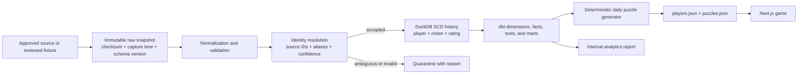

# Daily Roster NBA Data Warehouse and Game Platform

[Play Daily Roster](https://playdailyroster.app) · [Source code](https://github.com/adeoluwa-4/Roster) · [Verified pipeline report](analytics/pipeline_report.md)

Daily Roster is a polished daily NBA guessing game backed by a reproducible DuckDB and dbt Core data platform. Players have 10 guesses and receive six clues: draft year, position, conference, team, nationality, and height. The existing Next.js/vinext product, daily stats, share flow, help dialog, and responsive game experience remain intact.

The warehouse now generates both `data/players.json` and the date-keyed `data/puzzles.json` consumed by the application. The current approved input is one frozen 250-player fixture effective 2026-08-14. The system can track future snapshots historically, but the repository does not yet contain multi-season source coverage or an approved live NBA API.

## Architecture



The scheduled GitHub Actions workflow runs read-only each Monday and on demand. It installs from scratch, retries the orchestration step, runs Python validation, builds and tests dbt, exports the game data, runs the game build/tests, and uploads the database and report as evidence. Publishing changed datasets remains a reviewed Git operation.

## Warehouse model

DuckDB stores the local relational warehouse; dbt Core builds and tests the analytics layer.

| Layer | Models and tables |
|---|---|
| Raw | `raw.source_snapshot`, `raw.player_record` |
| Identity and quality | `core.player_identity`, `core.player_alias`, `core.identity_resolution_event`, `core.quarantine_player_record` |
| SCD history | `core.player_history`, `core.roster_history`, `core.rating_history` |
| Dimensions | `dim_player`, `dim_team`, `dim_season`, `dim_country`, `dim_position` |
| Facts and bridge | `bridge_player_team_history`, `fact_player_snapshot`, `fact_player_rating`, `fact_roster_membership`, `fact_daily_puzzle`, `fact_pipeline_run` |
| Marts | `mart_current_player_pool`, `mart_player_history`, `mart_daily_puzzle_candidates` |

Stable internal UUIDs identify players. NBA, ESPN, fixture, and future source identifiers are retained as aliases rather than used as warehouse keys.

## Identity resolution and historical tracking

Names are accent-folded, suffixes removed, and punctuation normalized. Teams, positions, and countries use documented canonical mappings. Matching proceeds in this order:

1. persisted source identifier alias;
2. exact normalized identity;
3. scored fuzzy comparison.

Fuzzy matches must clear both a confidence threshold and a separation margin. Anything ambiguous is written to quarantine with its payload and explicit reason. Manual aliases persist corrections across later runs.

Player metadata, roster membership, and rating rows use `valid_from`, `valid_to`, and `is_current`. A changed content hash closes the prior row and inserts a new version; identical reruns leave history unchanged. The dbt quality suite checks unique IDs, recognized teams and positions, valid seasons, nonnegative ratings, reasonable heights, one current row per entity, nonoverlapping ranges, complete puzzle clues, unique puzzle dates, and valid lineage.

## Source policy

Scheduled runs currently ingest only committed, reviewed snapshots. NBA2KLab and undocumented ESPN endpoints are not approved live sources. The legacy collector fails closed by default. See [the full source policy](data/SOURCE_POLICY.md) before adding or refreshing any provider.

## Run the pipeline

Requirements: Python 3.12+, Node.js 22+, and npm.

```bash
python3 -m venv .venv
.venv/bin/pip install -r requirements.txt
npm ci

.venv/bin/python -m unittest tests.test_data_pipeline -v
.venv/bin/python -m pipeline.daily_roster run \
  --puzzle-start 2026-10-25 \
  --puzzle-days 90
```

The pipeline writes structured JSON logs and records every run, its runtime, dataset version, test results, and record counters in `ops.pipeline_run`. It generates `warehouse/daily_roster.duckdb`, `data/players.json`, `data/puzzles.json`, and `analytics/pipeline_report.md`.

### Backfill and recovery

Use an inclusive source date range for a bounded rebuild:

```bash
.venv/bin/python -m pipeline.daily_roster run \
  --start 2026-01-01 \
  --end 2026-12-31 \
  --puzzle-start 2026-10-25
```

Snapshots are loaded in effective-date order. To recover a disposable local warehouse, remove only `warehouse/daily_roster.duckdb` and its `.wal`, then rerun the command. Raw committed snapshots and generated application files are not deleted. Content hashes, unique constraints, and SCD merges make the reload idempotent; the automated test suite also exercises reruns and historical version closure.

## Verified clean-run results

On 2026-10-25, the pipeline was run from a deleted DuckDB database against the committed fixture:

- 250 records fetched and accepted; 250 stable player identities; 0 unresolved or quarantined records.
- 14 dbt models built; 40 dbt test nodes defined; the clean orchestration recorded 44 successful dbt test executions (including its targeted puzzle rebuild) and 0 failures; 7 Python data tests passed.
- 250-player application pool exported with dataset version `751eed3d78532443`.
- 90 deterministic puzzles generated for 2026-10-25 through 2027-01-22, featuring 76 distinct players.
- Production game build passed and all 4 rendered-game tests passed; recorded pipeline runtime was 12.1668 seconds on the local verification machine.

The generated [pipeline report](analytics/pipeline_report.md) is the source of truth for measured run metrics.

## Known limitations

- Only one approved snapshot is committed, so the SCD machinery is tested but the repository does not yet demonstrate multi-season NBA history.
- The fixture's 2026-08-14 effective date means its teams, ratings, and active flags should not be presented as live facts.
- No external basketball provider is scheduled until its API terms, storage rights, and redistribution rights are verified.
- The DuckDB file is a rebuildable local artifact and is intentionally not committed or queried by the public game at request time.
- The current npm dependency tree reports audit findings that should be reviewed separately before a dependency upgrade; the verified build itself passes.

## Truthful resume bullets

- Built a DuckDB and dbt Core data platform that resolves 250 player identities, preserves player/roster/rating changes with SCD history, quarantines invalid matches, and exports the dataset powering a production NBA guessing game.
- Implemented deterministic date-and-seed puzzle generation, idempotent snapshot ingestion, checksummed lineage, structured run metrics, and 40 dbt quality tests across 14 models.
- Integrated warehouse-generated player and puzzle data into an existing Next.js game and verified the clean pipeline with 7 Python tests, a production build, and 4 rendered-game tests.
